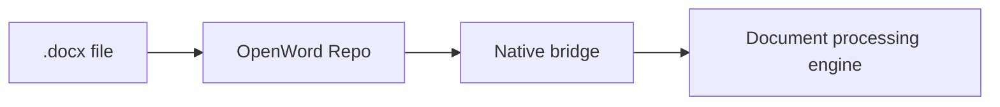

# OpenWord


CLI/SDK for Word `.docx` parsing, creation, and conversion. The processing engine handles all formats internally, exposing a native bridge to Node.js consumers and end users.

Key capabilities once fully wired: paragraph / table / style / image / header-footer fidelity, template-based `.docx` generation, and cross-format conversion with the rest of the OpenOffice family.

## 🧩 Architecture



## What's NOT here

- **No `.docx` parser or writer implementation** — the full processing pipeline (ZIP/OOXML parse, style model, image handling, section math) belongs in the shared engine. This repo consumes it as a dependency.
- **No fixture corpus** — golden files, conformance fixtures, and round-trip acceptance scripts live downstream. This repo only keeps minimal smoke-level tests.
- **No formula or spreadsheet logic** — that is OpenExcel's domain. OpenWord delegates table cell content that happens to contain formula expressions, not formula evaluation itself.

## 🚀 Usage (placeholder)

```bash
# Inspect structure — paragraphs, tables, images, sections
open-word inspect report.docx

# Convert to plain text or structured JSON
open-word export report.docx --format text -o report.txt

# Generate a new document from a template + data
open-word render template.docx --data values.json -o output.docx

# Convert to another Office format (requires OpenOffice family)
open-word convert input.docx output.pdf
```

```ts
import { OpenWord } from '@wae/open-word';

const doc = await OpenWord.read('report.docx');
console.log(doc.paragraphs.length, doc.tables.length);

const out = await OpenWord.render('template.docx', { author: 'Aster', date: '2026-11-19' });
await out.write('output.docx');
```

## 🧱 Repo layout

```
OpenWord/
├── package.json
└── Readme.md
```

This is a scaffold repo. The native bridge wiring, CLI binary, and CLI entry points are added incrementally as the shared processing engine lands.
